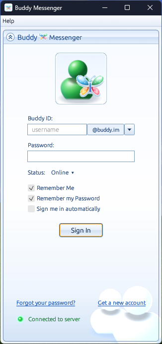

# Buddy Messenger

  <strong>The soul of 2009 messaging, rebuilt for today.</strong>

  A fast, secure, Windows desktop messenger combining classic MSN Messenger charm with a modern Windows 7 Frutiger Aero aesthetic.

  

---

## 🌟 Overview

Remember when logging on meant actually talking to your favorite people instead of scrolling through endless algorithmic feeds? **Buddy Messenger** is an exclusive Windows desktop application designed to bring back cozy, distraction-free messaging without the bloat, ads, or distraction traps of modern platforms.

- **Platform:** Windows 10 & 11 (64-bit)

---

## ✨ Key Features

* **Zero Bloat:** No ads, no algorithmic feeds. Just a clean space to add the people you care about and chat.
* **Modern Privacy & Security:** Encrypted chats by default. Messages are secure and cannot be read via the server, not even by administrators.
* **High Performance:** Powered by Rust, running light at around ~110 MB RAM. Fast, responsive, and smooth.
* **Classic MSN Nostalgia:** Features classic online sign-in chimes, rich file sharing, emojis, and even the iconic MSN Nudge feature!
* **Frutiger Aesthetic:** Sleek Windows 7 themes and a 3D volumetric glass butterfly emblem design.
* **Classic Buddy List:** Keep track of who is online with a familiar, retro-inspired contact list.
* **Group Chats (Up to 10 People):** Have group chats with up to 10 people!

---

## 📥 Installation

1. Head over to the [Buddy Messenger Website](https://cjgsoftware.netlify.app/buddymessenger) or grab the latest build from the **Releases** tab on the right.
2. Download the installer for Windows 10 & 11 (64-bit).
3. Run the installer and sign in to start chatting!

---

## 🔒 Encryption and Security

Buddy keeps your messages and account safe by scrambling your data into unreadable code before it ever leaves your computer. When you send a message, file, or nudge, the app encrypts the text with a secure key unique to the conversation between you and your friend - meaning anyone looking directly at the server database only sees random gibberish, and only you and your friend's app hold the key to decode it. On top of that, your passwords are never saved in plain text (the server only verifies them using irreversible cryptographic hashes), all data travels over secure HTTPS connections so no one on your Wi-Fi can spy on it, and any login details you choose to remember on your PC are locked inside an encrypted vault (`vault.dat`) in %appdata% rather than readable files.

---

## 📄 License

Copyright © 2026 Connor Julian-Golding. All rights reserved.
